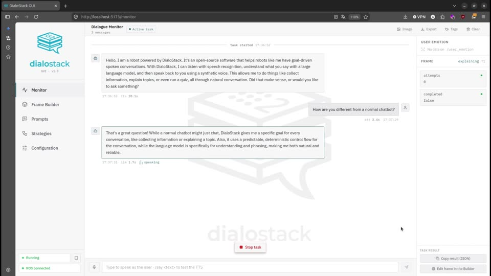
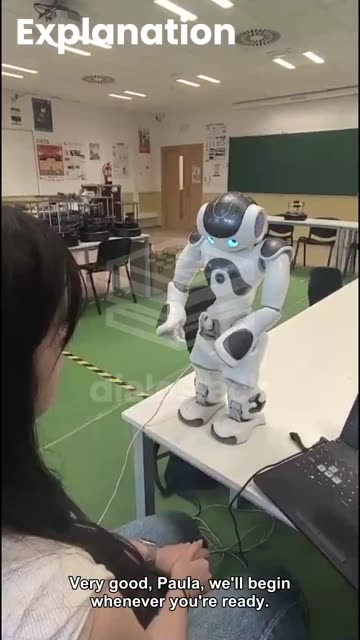
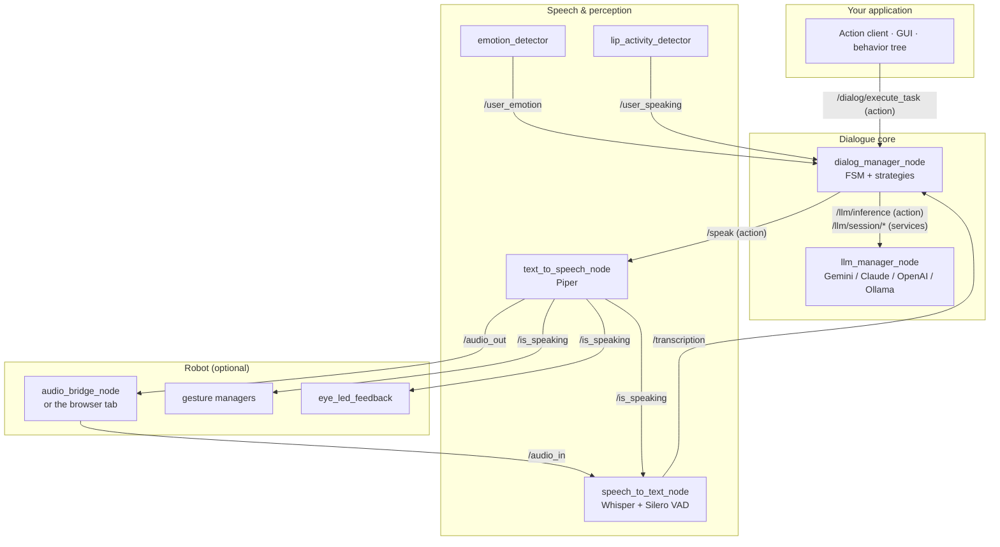

<p align="center">
  <a href="https://aquintan4.github.io/DialoStack/"></a>
</p>

<h3 align="center">Give your ROS 2 robot a voice that gets things done.</h3>

<p align="center">
  Open-source, LLM-powered <strong>spoken dialogue stack for ROS 2</strong>: speech recognition, a deterministic dialogue engine,<br/>
  text-to-speech and a web GUI, in one <code>docker run</code>. Works with Gemini, Claude, OpenAI or a local Ollama model.
</p>

<p align="center">
  <a href="https://github.com/aquintan4/DialoStack/releases"></a>
  <a href="https://github.com/aquintan4/DialoStack/pkgs/container/dialostack"></a>
  
  
  
  
  <a href="LICENSE"></a>
</p>

<p align="center">
  <a href="https://aquintan4.github.io/DialoStack/"><b>Website</b></a> ·
  <a href="#quick-start"><b>Quick start</b></a> ·
  <a href="#demo"><b>Demo</b></a> ·
  <a href="#documentation"><b>Docs</b></a> ·
  <a href="docs/architecture.md"><b>Architecture</b></a> ·
  <a href="https://github.com/aquintan4/DialoStack/issues"><b>Issues</b></a>
</p>

---

**DialoStack** lets a robot hold **goal-driven spoken conversations**: take an order and return it as JSON, explain hospital instructions and check they were understood, run a quiz, guide a user step by step through an exercise, or play an interviewer so the user can practise and get scored. It runs entirely by voice, in any language, on any ROS 2 robot, or with no robot at all: the browser tab can be the microphone and speaker.

The core idea is **deterministic control, probabilistic understanding**. Phases, turn limits, confirmations and cancellation are plain, tested Python. The LLM only does what it is good at: understanding what the user said and phrasing the next reply. You get a conversation that feels natural and a behavior you can predict, debug and test.

## Demo

<table>
  <tr>
    <td align="center" width="62%">
      <a href="https://www.dropbox.com/scl/fi/w5niqwi23jtkye2zqfchh/Dialostack_promovideo.mp4?rlkey=jj4j1s0wgb9hvf9hmm2ylkvjy&st=ut60mwo6&dl=0"></a><br/>
      <strong>Promo video</strong> (2:42): the stack and the GUI in action
    </td>
    <td align="center" width="38%">
      <a href="https://www.dropbox.com/scl/fi/8m9e1r847z0sdi19mkjvc/DialoStackDemo_nao.mp4?rlkey=o7q0q24v26ibxkt071y1jh10v&st=kdo1be3j&dl=0"></a><br/>
      <strong>Full demo on a real NAO</strong> (4:06): live spoken dialogue with a user
    </td>
  </tr>
</table>

## Quick start

With [Docker](https://www.docker.com/products/docker-desktop/) installed (Linux or Windows 11):

```bash
docker run -d --name dialostack -p 5173:5173 -p 9090:9090 ghcr.io/aquintan4/dialostack
```

1. Open **http://localhost:5173**.
2. Enter an API key in **Configuration > LLM** ([Gemini's free tier](https://aistudio.google.com/apikey) works), or pick a local Ollama model.
3. Press **Start engine**, allow the microphone, and talk.

The browser tab is the robot's microphone and speaker, so there is no audio setup. For an NVIDIA GPU (`:latest-cuda`), Docker Compose, host audio, Windows specifics or a source build in your ROS 2 workspace, see the **[installation guide](docs/installation.md)**.

## Why DialoStack

| | A chatbot with a microphone | DialoStack |
|---|---|---|
| **Goal** | Open-ended chat | A task with an end: collect data, teach, quiz, guide, rehearse |
| **Who decides what happens next** | The LLM | A tested state machine; the LLM understands and phrases |
| **Output** | A transcript | Structured results (`final_frame_json`, scores, completed steps) |
| **When the model misbehaves** | The conversation derails | Timeouts, bounded retries and deterministic fallbacks |
| **Robot integration** | Up to you | ROS 2 actions and topics, gestures, eye LEDs, remote audio |
| **Vendor lock-in** | One API | Gemini, Claude, OpenAI, any OpenAI-compatible server or Ollama, switchable in one field |

## Five dialogue strategies

Every conversation is a **strategy**, picked with one field of the goal. They share cancellation ("stop, forget it"), timeouts and barge-in, and you can [register your own](docs/architecture.md#the-strategy-contract).

| Strategy | The robot… | Returns | Example use |
|---|---|---|---|
| 🧾 **`slot_filling`** | Asks for the data it needs, accepts corrections, validates types, ranges and conditions, then confirms | The completed frame as JSON | Orders, check-in, intake forms, surveys |
| 📖 **`explanation`** | Explains a topic, asks a comprehension question, answers follow-ups, rephrases if needed | Whether it was understood | Patient instructions, onboarding, museum guide |
| ❓ **`quiz`** | Asks questions from a bank, grades free-form spoken answers | The score per question | Education, cognitive exercises, trivia |
| 🪜 **`procedure`** | Guides through steps, helps when stuck, repeats, goes back or skips on request | Which steps were completed | Physiotherapy, assembly, recipes, checklists |
| 🎭 **`roleplay`** | Plays a character in a scene, gives hints on request, then scores a rubric from 1 to 5 | The score and feedback per criterion | Job interviews, language practice, soft-skills training |

You do not even need a schema: describe the task in plain language and the engine designs the slots itself.

## Features

- 🗣️ **Full speech pipeline.** faster-whisper + Silero VAD for STT, streaming Piper TTS, automatic self-muting, and **barge-in**: the user can interrupt the robot mid-sentence.
- 🧠 **Any LLM, one interface.** Gemini, Claude, OpenAI (or vLLM, LM Studio, OpenRouter through `base_url`) and local Ollama, with JSON-constrained outputs, streaming, prompt caching and separate NLU/NLG sessions per dialogue.
- 🖥️ **Web GUI.** Monitor the conversation live with per-turn latencies, build frames, quizzes, procedures and roleplay scenes visually, edit every prompt, save configuration profiles and export sessions to CSV, JSON or Markdown.
- 🎙️ **Audio anywhere.** Local devices, the browser tab, or raw PCM over ROS (`AudioChunk`): capture on the robot's head, run Whisper and the LLM on a GPU machine.
- 👀 **Multimodal context.** Facial emotion and lip-activity detection feed the user's state into the prompts, so the robot can adapt its tone.
- 🤖 **Embodiment.** Talking gestures, postures and eye-LED feedback for the SoftBank NAO, in RViz and on the real robot. Nothing in the core is NAO-specific.
- 🌍 **Any language.** One parameter switches the prompts and the fixed phrases.
- 🐳 **One-command deploy.** CPU and CUDA Docker images, compose files for Linux and Windows 11, automatic GPU detection.
- 🌳 **Behavior trees.** A [BehaviorTree.CPP](dialostack_bt_client) leaf node runs a dialogue as one step of a larger robot mission.
- 📊 **Measured, not guessed.** A ROS-free [evaluation suite](evaluation) (P/R/F1, confusion matrices, task completion) and 363 unit tests.

## The web GUI

<p align="center">
  
</p>

| Page | What you do there |
|---|---|
| **Monitor** | Follow the dialogue live: transcriptions, replies, STT/LLM/TTS timings, barge-in marks, the frame filling up, the user's emotion. Type as the user, launch tasks, export the session |
| **Frame Builder** | Design slot schemas (types, canonical values, ranges, conditional slots), quiz banks, procedure steps and roleplay scenes, and keep them in a library |
| **Prompts** | Override any prompt template, with placeholder validation |
| **Strategies** | Edit the fixed phrases of each strategy, per language |
| **Configuration** | Provider and model, dialogue limits, STT, TTS, audio routing, saved as named profiles |

## Architecture



The user speaks and `speech_to_text_node` publishes the transcription. The active **strategy** asks the LLM to interpret it (NLU), updates its state, then asks the LLM to phrase the reply (NLG). The reply is spoken through `/speak`; `/is_speaking` mutes the microphone and drives gestures and LEDs. Emotion and lip activity stream in as live context. Full design: **[docs/architecture.md](docs/architecture.md)**.

## Your first dialogue

Everything goes through one ROS 2 action, **`/dialog/execute_task`**. From the GUI, use the launch drawer in the Monitor. From ROS:

```bash
ros2 action send_goal --feedback /dialog/execute_task \
  ros2_dialog_interfaces/action/DialogTask \
  "{task_description: 'Take a coffee order: drink type, size and customer name',
    dialog_mode: 'slot_filling',
    domain: 'coffee shop'}"
```

The robot greets the user, asks for each missing slot, handles corrections ("actually, make it a large"), confirms, and returns the order in `result.final_frame_json`. Supply your own schema with `frame_schema_json` ([format](docs/slot_schema.md)), resume with `initial_frame_json`, or chain dialogues with `skip_intro`.

<details>
<summary><b>Goals for the other strategies</b> (explanation, quiz, procedure, roleplay)</summary>

**Explanation** explains something and checks it was understood:

```bash
ros2 action send_goal /dialog/execute_task \
  ros2_dialog_interfaces/action/DialogTask \
  "{task_description: 'Explain the pre-surgery fasting instructions',
    dialog_mode: 'explanation',
    resources_json: '[{\"name\": \"instructions\", \"description\": \"fasting protocol\", \"content\": \"No food 8 hours before...\"}]',
    domain: 'hospital'}"
```

**Quiz** runs interactive Q&A with scoring:

```bash
ros2 action send_goal /dialog/execute_task \
  ros2_dialog_interfaces/action/DialogTask \
  "{task_description: 'Run a short geography quiz',
    dialog_mode: 'quiz',
    resources_json: '[{\"name\": \"questions\", \"description\": \"quiz bank\", \"content\": \"[{\\\"question\\\": \\\"Capital of France?\\\", \\\"answer\\\": \\\"Paris\\\"}]\"}]'}"
```

**Procedure** guides the user step by step and lets them repeat, go back or skip:

```bash
ros2 action send_goal /dialog/execute_task \
  ros2_dialog_interfaces/action/DialogTask \
  "{task_description: 'Guide a short shoulder warm-up',
    dialog_mode: 'procedure',
    resources_json: '[{\"name\": \"steps\", \"description\": \"Procedure steps\", \"content\": \"[\\\"Sit up straight with your feet flat on the floor\\\", {\\\"step\\\": \\\"Roll your shoulders back slowly five times\\\", \\\"check\\\": \\\"no pain\\\"}]\"}]'}"
```

**Roleplay** plays a character; the user can ask for a hint at any moment, and at the end the robot steps out of the role and scores each criterion from 1 to 5:

```bash
ros2 action send_goal /dialog/execute_task \
  ros2_dialog_interfaces/action/DialogTask \
  "{task_description: 'Practise a job interview',
    dialog_mode: 'roleplay',
    resources_json: '[{\"name\": \"scene\", \"description\": \"Roleplay scene\", \"content\": \"{\\\"scenario\\\": \\\"Interview for a robotics internship\\\", \\\"role\\\": \\\"The HR interviewer: demanding but kind\\\", \\\"criteria\\\": [\\\"Answers clearly\\\", \\\"Gives concrete examples\\\"]}\"}]'}"
```

</details>

Per-turn **feedback** (phase, frame, last utterance) streams while the dialogue runs; the **result** reports success, the collected data and the turn count. Users can cancel by voice at any time: the engine detects the intent, asks for confirmation and aborts cleanly.

## Run it on a robot

- **NAO (SoftBank).** The [`robots/nao`](robots/nao) layer adds talking gestures, idle poses and eye LEDs (blue idle, green listening, pulsing white speaking), in RViz and on the real robot. `nao_min.launch.py` runs the microphone and speaker bridge on the NAO while the models run on a laptop.
- **Any other ROS 2 robot.** Publish its microphone on `/audio_in` and play `/audio_out` (or run `audio_bridge_node` on it), and map `/is_speaking` and `/target_pose` to its effectors. The dialogue core has no robot-specific code.

```bash
ros2 launch speech_io audio_bridge.launch.py                 # on the robot: mic + speaker over ROS
ros2 launch nao_pose_manager arm_gesture_manager.launch.py   # NAO arm gestures and eye LEDs
```

## Documentation

| Guide | Contents |
|---|---|
| [Installation](docs/installation.md) | Docker (Linux, Windows 11, NVIDIA GPU) and source builds |
| [Architecture](docs/architecture.md) | Node graph, dialogue FSM, strategies, LLM sessions, audio routing, GUI, extension points |
| [Configuration](docs/configuration.md) | Every parameter of every node, prompts and launch files |
| [Slot schema](docs/slot_schema.md) | Types, canonical values, ranges and conditional slots |
| [Evaluation](evaluation/README.md) | Benchmarks, datasets and how to compare models |
| [Behavior trees](dialostack_bt_client/README.md) | Running dialogues from BehaviorTree.CPP |
| [GUI internals](dialostack_gui/src/README.md) | How the web app is built and extended |

<details>
<summary><b>Repository layout</b></summary>

| Path | What it is |
|------|------------|
| [`ros2_dialog_manager/`](ros2_dialog_manager) | The dialogue engine: FSM, strategies, frame, prompt builder, LLM client |
| [`ros2_dialog_interfaces/`](ros2_dialog_interfaces) | Public API: `DialogTask` and `SpeakText` actions, `AudioChunk` and `BargeIn` messages |
| [`ros2_llm_manager/`](ros2_llm_manager) | LLM backend node: providers, sessions, inference action |
| [`ros2_llm_interfaces/`](ros2_llm_interfaces) | `LlmInference` action and session services |
| [`speech_io/`](speech_io) | STT, TTS and the audio bridge |
| [`vision_io/`](vision_io) | Emotion and lip-activity detection nodes |
| [`dialostack_gui/`](dialostack_gui) | Web GUI: React app and its Python server |
| [`robots/nao/`](robots/nao) | NAO layer: URDF, gestures, eye LEDs, pose tooling |
| [`dialostack_bt_client/`](dialostack_bt_client) | BehaviorTree.CPP leaf node |
| [`evaluation/`](evaluation) | ROS-free benchmark suite with annotated datasets |
| [`docker/`](docker) | Docker image (CPU and CUDA variants) |

</details>

## Testing & evaluation

```bash
cd ros2_dialog_manager && python3 -m pytest test/ -q   # 267 tests, no ROS needed
cd dialostack_gui && npm test                           # 96 tests (Vitest)
cd evaluation && python run_eval.py --benchmark all --save
```

The [evaluation suite](evaluation/README.md) measures slot extraction (P/R/F1), intent classification, mode detection, quiz grading and full simulated dialogues against hand-annotated datasets, with any configured provider.

## Contributing

Bug reports, feature requests and pull requests are welcome in [GitHub issues](https://github.com/aquintan4/DialoStack/issues). New strategies, robot layers and LLM providers are the most useful contributions: each is a single class behind a documented contract ([extension points](docs/architecture.md#extension-points)).

If DialoStack is useful to you, a ⭐ helps other roboticists find it.

## Support & custom integrations

Need DialoStack adapted to your robot, language or use case? I offer integration, custom dialogue strategies and deployment support: **[dialostacksupport.quotation181@passmail.net](mailto:dialostacksupport.quotation181@passmail.net)**.

## Citation

```bibtex
@software{dialostack,
  author = {Quintana, Álvaro},
  title = {DialoStack: an LLM-powered spoken dialogue stack for ROS 2 robots},
  year = {2026},
  url = {https://github.com/aquintan4/DialoStack}
}
```

## License

[MIT](LICENSE). The vendored `robots/nao/nao_description/` (NAO URDF and meshes) is third-party, under Apache-2.0 and BSD with its own `LICENSE` and `NOTICE`.
